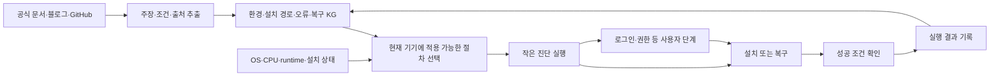

# 설치 지식 KG와 자동 복구 설계

2026-10-17 · 후속 논의안 · 기존 agent 실행 경로 우선

이 제품의 중심을 **설치 방법을 알고, 현재 환경을 읽고, 실패 이유에 맞는 다음 단계를 고르는 설치 서비스**로 잡는다. 웹사이트의 가이드, GitHub의 skill·설치 정의, 실제 설치기가 하나의 지식을 사용하도록 설계한다.

사용자 결정은 두 가지다. 모바일에서도 기존 Claude Code·Codex·Prime Agent 실행 경로를 우선하고, 공식 가이드·블로그·GitHub에서 얻은 지식을 KG로 만들어 예외 대응에 사용한다. 개별 기기 실험 결과가 있어야 기획을 진행할 수 있다는 전제는 두지 않는다. 실행 성공 확인은 설치 과정과 출시 검증에 포함한다.

## 지식이 들어와 실행 경험으로 이어지는 흐름

그래프는 근거와 관계를 보관한다. 실제 변경은 범위·권한·실행 조건이 정의된 절차가 담당한다. 이 둘을 연결해야 “관련 문서 검색”에서 “지금 기기에 맞는 다음 행동”으로 이어진다.

## KG에 담을 것

| 개체 | 예 | 필요한 정보 |
|---|---|---|
| Agent | Claude Code, Codex, Prime Agent | 정확한 프로젝트, 원본 배포처, agent 정체성 |
| Release | 특정 버전의 Linux ARM64 배포 파일 | version, source commit, artifact URL, digest, CPU·ABI |
| Environment | Android ARM64 / Termux / Ubuntu userland | OS·version·CPU·libc·runtime·사용자 권한·전원 상태 |
| Route | Termux에서 PRoot Linux를 준비하고 원본 CLI 실행 | 선행 조건, 단계, 원본 변경 여부, 예상 제약 |
| Symptom | 실행 파일이 있는데 `No such file or directory` | exit code, stderr, 발생 단계, 정규화한 특징 |
| Diagnostic | CPU·ELF interpreter·파일 존재 확인 | 읽기 범위, 결과 parser, 판정식 |
| Recovery | 맞는 artifact 선택 또는 호환 userland 준비 | 적용 조건, 변경 범위, 재시도, 되돌리기, 성공 확인 |
| HumanStep | 로그인, MFA, 서비스 권한 동의 | 공식 화면, 필요한 입력, 복귀 조건 |
| Claim·Source | 특정 가이드가 특정 조건의 성공을 보고 | URL·작성자·확인일·문서/commit 버전·근거 위치 |
| Observation | 특정 환경에서 특정 절차를 실행한 결과 | 실행 환경, 실행 단계, 결과물·오류, 재현 수준 |

관계는 `requires`, `applies_to`, `fails_with`, `diagnosed_by`, `resolved_by`, `verified_by`, `reported_by`, `conflicts_with`, `supersedes` 등을 사용한다. 단순 제품 이름끼리 연결하기보다 **조건이 붙은 주장과 절차**를 중심에 둔다.

예를 들어 “Android에서 Codex가 된다”는 정보만으로는 부족하다. Android 버전·ARM64 여부·Termux native인지 PRoot Linux인지·Codex 버전·변경 없는 upstream binary인지·어떤 도구까지 실행했는지를 함께 저장해야 한다.

## 출처와 검증 상태

| 상태 | 의미 | 설치기에 주는 정보 |
|---|---|---|
| 공식 문서에 명시 | 프로젝트가 지원·조건·절차를 설명 | 공식 경로 후보와 요구사항 |
| 커뮤니티 성공 보고 | 글·issue·repo 작성자가 실행했다고 보고 | 해당 환경과 버전의 대안 후보 |
| 소스에서 확인 | artifact·코드·설정에 기능 또는 조건이 존재 | 호환성 판단 근거; 실행 성공과는 별개 |
| 직접 재현 | 기록한 환경에서 해당 단계를 실제 실행 | 그 환경·버전·검증 범위의 성공 근거 |
| 추론·설계 제안 | 여러 근거를 연결해 만든 후보 | 탐색·시험 대상으로 유지 |
| 충돌·만료 | 최신 버전과 모순되거나 적용 범위가 불명확 | 자동 실행 후보에서 제외하고 재조사 |

Graphify의 `EXTRACTED / INFERRED / AMBIGUOUS` 구분을 관계 추출에 적용한다. `EXTRACTED`는 출처에 그 관계가 명시됐다는 의미이며, 그 관계가 현재 모든 기기에서 참이거나 우리가 재현했다는 의미는 아니다. 실행 증거 상태와 추출 상태를 별도 필드로 저장한다.

블로그·GitHub guide도 적극 활용한다. 작성자가 직접 겪은 환경·로그·버전이 있는 사례를 우선하고, 중요한 기술 전제는 원본 프로젝트 문서·소스와 대조한다. 오래된 글의 명령을 최신 패키지에 그대로 적용하지 않도록 source와 recipe version을 묶는다.

## 자동 복구의 동작 계약

1. 환경과 실패 단계, exit code·stderr·기대 결과물을 읽는다.
2. KG에서 동일 증상과 관련 진단을 찾는다. 오류 문구만으로 원인을 확정하지 않는다.
3. OS·CPU·libc·agent version·필수 도구·권한 조건으로 적용할 수 없는 절차를 제거한다.
4. 남은 경로가 여럿이면 근거·변경 범위·성공 이력으로 순위를 정한다. Jev의 후보 선택은 참고로 쓸 수 있다.
5. 먼저 작은 진단으로 원인을 구분하고, 정해진 설치·복구 단계를 실행한다.
6. 성공 조건을 실제 확인한다. 프로세스 종료 코드 하나만으로 완료를 선언하지 않는다.
7. 결과를 Observation으로 추가하고, 같은 오류의 반복·새로운 오류·인증 대기 등을 구분해 다음 단계를 선택한다.

계정·MFA·결제·OS 권한 같은 사용자 단계는 안내 화면을 열고 완료 상태를 기다린다. 이미 끝낸 설치 단계는 다시 하지 않는다. 승인된 작업 범위 안의 알려진 복구는 자동으로 진행하고, 필요한 새로운 권한이나 사용자 입력이 생긴 경우에만 그 단계로 이동한다.

처음 보는 오류는 최소한의 환경·version·실패 단계로 관련 공식 문서와 GitHub 사례를 다시 찾는다. 기존에 검증한 동작으로 해결할 수 있으면 적용 조건을 확인해 진행한다. 새로운 복구 절차가 필요하면 별도 후보로 만들고 제한된 시험과 성공 확인을 거쳐 배포 지식에 반영한다. 같은 상태에서 같은 행동을 반복하지 않도록 오류·환경·시도한 절차의 fingerprint와 재시도 상한을 기록한다.

## 복구 절차 하나에 필요한 필드

- `preconditions`: OS/CPU/ABI/version 범위, 필요한 파일·runtime·권한.
- `symptom_match`: 실패 단계와 출력 특징. 이것은 원인 후보를 찾는 조건이다.
- `diagnostics`: 읽기 전용 검사와 기대 구조.
- `steps`: 승인된 작업 범위 내 실행할 도구·인자·입출력 경로.
- `success_checks`: 버전 확인, 로컬 파일 작업, 실제 tool 사용 등 필요한 검증.
- `mutation_scope`: 바꾸는 파일·패키지·서비스와 유지해야 할 사용자 설정.
- `rollback`: 되돌릴 수 있는 변경과 저장된 설정·파일의 복원 방법.
- `retry_budget`: 같은 원인에 대한 재시도 상한과 다른 경로로 넘어갈 조건.
- `human_checkpoints`: 로그인·권한·결제와 복귀 조건.
- `evidence_refs`: 근거 source/claim/observation ID와 적용 version.

문서에서 추출한 shell 문자열을 즉시 자동 실행하는 기능으로 만들지 않는다. 검토된 절차의 고정된 도구·인자와 환경값을 연결하는 구조를 제안한다. 최신 가이드는 후보를 갱신하는 근거가 되고, 이미 배포한 절차의 version과 변경 이력은 보존한다.

초기 저장 형식은 version 관리 가능한 JSON/YAML과 관계 index로 충분하다는 제안이다. 먼저 source·claim·recipe·observation의 식별자와 schema를 고정하고, 검색 규모와 운영 조건이 정해진 뒤 graph DB를 선택한다. 설치기는 필요한 팩의 승인된 절차를 내려받아 기기에서 진단·실행하며, 중앙 지식 저장소가 agent의 실행 host가 되는 구조로 바꾸지 않는다.

사이트의 설명·개발자용 설치 정의·초보자용 화면은 같은 recipe에서 생성한다. 예외가 해결되면 비밀정보를 제외한 환경·version·증상·결과를 기록하고, 공유 여부는 사용자 설정에 따른다. 새 관측 한 건으로 모든 환경의 지원 상태를 바꾸지 않는다.

## 대표적인 예외 분기

| 관측한 상황 | 먼저 확인할 것 | 지식에 기록할 대응 |
|---|---|---|
| 실행 파일이 있으나 실행 불가 | CPU, 실행 권한, ELF interpreter, 필요한 library | 파일 누락·architecture 불일치·loader 부재를 나눠 맞는 artifact/userland 선택 |
| npm에 Android platform package가 없음 | 설치한 package/version과 실제 배포 target | package 이름을 임의로 바꾸지 않고, 동일 agent의 공식 Linux artifact를 쓸 수 있는 환경 경로 검토 |
| PRoot 안의 namespace·sandbox 오류 | kernel 기능 요구, 중첩 PRoot 여부 | 지원되지 않는 기능을 분리. sandbox 해제를 일반 자동 복구로 삼지 않음 |
| browser 로그인이 돌아오지 않음 | 공식 로그인 방법, callback 위치, VM network | 공급자가 제공하는 device/manual login 경로 또는 올바른 callback 연결 안내 |
| 화면을 끄면 작업 중단 | Android/iOS background 제한, process 종료 여부 | checkpoint 저장·foreground 복귀·이어하기; 상시 실행 보장과 구분 |
| 설치 뒤 update로 재발 | 이전·현재 artifact와 wrapper version 차이 | 변경된 조건 탐지, 해당 경로 보류, 검증된 version 복귀 여부 판단 |
| 종료 코드는 0인데 stderr에 권한 오류 | 실제 접근 성공과 기대 결과물 존재 | 성공으로 기록하지 않고 권한·사용자 범위 문제로 분류 |

이 표는 복구 정책 설계이며 위의 모든 상황에서 명령 실행이 검증됐다는 의미는 아니다.

구체적인 출발 사례는 [Codux](https://github.com/Clock-Skew/Codux)다. 작성자는 Android ARM64의 Termux에서 Debian PRoot를 준비하고 공식 Codex Linux ARM64 musl 배포 파일을 설치하는 경로를 제시한다. 설치 뒤 Codex가 실행되지 않을 때 Debian 안에 있는지 확인하는 단계도 제공한다. KG에는 이것을 **커뮤니티가 보고한 원본 Codex 경로와 runtime 진단 사례**로 넣는다. 이 글이 현재 모든 version에서의 실행을 증명하는 것으로 기록하지 않는다.

[PRoot-Distro 원본 문서](https://github.com/termux/proot-distro/blob/master/README.md)는 PRoot 중첩 제한, kernel namespace·cgroup 제약, init/service 제약을 명시한다. 따라서 `PRoot에 들어갔음`을 `완전한 Linux VM·보안 격리·상시 daemon을 얻었음`으로 연결하지 않는다. 각 기능에 필요한 조건을 별도 관계로 기록한다.

## 원본 agent 보존 수준

| 수준 | 예 | 현재 기본 경로에서의 취급 |
|---|---|---|
| 원본 배포 파일 그대로 | PRoot/VM 안에서 공식 binary 실행 | 우선 조사 |
| 원본 소스 그대로 재빌드 | 별도 Android target build | 공식 배포와 분리한 후속 후보 |
| 호환성 변경 | ELF interpreter 수정, loader shim | 변경점·원본 digest·결과 digest를 표시하는 별도 후보 |
| 별도 fork·자체 agent | 동작 변경 또는 모델 API만 사용하는 새 앱 | 이번 기본 경로로 대체하지 않음 |

PRoot나 VM이 기기 안에서 돌아가면 agent도 그 기기 안에서 실행될 수 있다. 다만 userland·CPU·system call·도구 호환성과 성능은 경로별로 확인해야 한다. 원격 PC나 cloud agent로 바꾸는 fallback은 이 요구의 해결로 기록하지 않는다.

## 우선 조사 범위와 다음 산출물

Android는 Termux와 로컬 Linux userland 경로를 우선 정리하고, iOS는 iSH/a-Shell/UTM 계열에서 원본 실행에 필요한 CPU·runtime 조건을 검토한다. 개별 agent를 새로 구현하는 작업은 하지 않는다.

1. 모바일 원본 agent guide와 알려진 오류를 근거별로 정리한다.
2. 이 중 조건과 해결 근거가 분명한 사례를 작은 KG seed로 만든다.
3. source/claim/route/diagnostic/recovery/verification 연결과 예외 분기를 검토한다.
4. 이후 설치기 구현 단계에서 이 절차를 실행하고 실제 Observation을 쌓는다.
5. 같은 구조를 DB·n8n·브라우저·미디어·판매 채널의 설정·credential 오류로 넓힌다.

이번 산출물은 KG와 실행 정책의 기획·초기 데이터다. 사용자 기기에 설치하거나 자동 복구 엔진을 배포한 상태로 표시하지 않는다.

## 현재 만들어 둔 초기 자료

- 기계가 읽을 KG와 복구 절차 후보: [graph.json](https://github.com/jimmylegendary/agent-welcome/blob/main/kg/graph.json)
- 출처 해석·검토 수정·검증 기록: [GRAPH_REPORT.md](https://github.com/jimmylegendary/agent-welcome/blob/main/kg/GRAPH_REPORT.md)
- Android 원본 agent 경로와 알려진 오류: [android-original-agent-validation.md](https://github.com/jimmylegendary/agent-welcome/blob/main/android-original-agent-validation.md)
- iOS 원본 agent 경로와 runtime 제약: [ios-original-agent-validation.md](https://github.com/jimmylegendary/agent-welcome/blob/main/ios-original-agent-validation.md)

JSON에는 agent·runtime·증상·진단·복구 후보·성공 확인의 연결을 담았다. 초기 복구 사례는 Codex 실행 문맥, Codex callback 로그인, Prime glibc, iSH bitness, PRoot sandbox의 다섯 가지다. 실제 실행 결과가 생기면 별도의 Observation을 추가하고, 해당 환경·version에서 검증된 절차만 실행 가능한 배포 팩으로 올리는 것을 다음 구현 단계로 제안한다.
